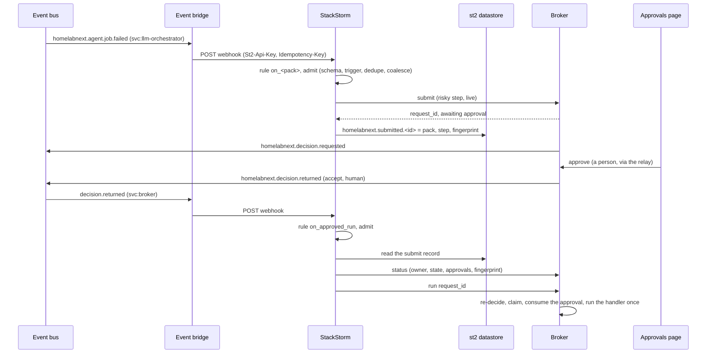

<!-- SPDX-License-Identifier: Apache-2.0 -->
# StackStorm: when workflow packs run

A [workflow pack](workflows.md) ([[workflows]]) says *what* happens when an event arrives. StackStorm
decides *when*: it takes events from the bus and ticks from its own clock, filters them with rule
criteria, holds a burst back, and starts one run per admitted event. Everything a run changes goes
through the [broker](broker.md) ([[broker]]). StackStorm holds no credential for any target.

Command: `hnx workflows st2 render | check | bridge`. Library: `homelabnext.workflows.st2` (the renderer
and its checks), `homelabnext.workflows.st2_runtime` (what a run executes) and
`homelabnext.workflows.st2_bridge` (the event bridge). Binding:
`workflows/stackstorm.yml` (`schemas/workflows/stackstorm`). Rendered pack, committed:
`workflows/stackstorm/`. `make workflows` fails when that tree drifts from its inputs.

## Who owns what

| Concern | Owner | Here |
|---|---|---|
| When a pack runs: events, schedules, burst control, shadow or live | **StackStorm** | rules and CronTimers rendered from the binding |
| What a run does: the steps, in order, with the offline runner's semantics | **workflow pack** | `workflows/packs/`, pinned by digest in `workflows/deploy.yml` |
| Every effect, every approval, every audit record | **broker** | the actions in `workflows/broker.manifest.json`, called over its Unix socket |
| Agent sessions: queue, admission against live load, leases, failover, in-run retries (`max_attempts`) | **orchestration controller** | reached only through the broker action `agent.job.submit` |

StackStorm never runs an agent and never calls the controller. To run agent work it asks the broker
for `agent.job.submit`, and the broker's handler puts one job on the controller's queue. A burst of
events therefore becomes queued jobs that the controller admits at its own pace (the LL-399 burst
risk), never a burst of agent processes.

## How a pack maps

`hnx workflows st2 render` reads the binding, the deploy pins and the packs. It writes this tree:

| File | From | What it is |
|---|---|---|
| `homelabnext/pack.yaml`, `config.schema.yaml`, `requirements.txt` | the binding | the StackStorm pack (`st2_pack`, `version`) |
| `homelabnext/actions/admit.{yaml,py}`, `step.{yaml,py}` | fixed | the only two Python actions: shims over `st2_runtime.admit` and `st2_runtime.step` |
| `homelabnext/actions/<pack>.yaml` | each bound pack | an `orquesta` action with one string input: `event` (the encoded webhook body) or `fired_at` |
| `homelabnext/actions/workflows/<pack>.yaml` | each bound pack | task `admit`, then one task per pack step, in order. A task names its pack and step id; it never carries a step document, a mode or event data in clear. |
| `homelabnext/pinned/<pack>.json` | each bound rule | what the actions run: the pack document and its digest, the rule's `mode`, each step's risk, the coalesce window and the schedule |
| `homelabnext/rules/on_<pack>.yaml` | each bound rule | the trigger and criteria below; the one parameter is the encoded body |
| `configs/homelabnext.yaml` | the binding | the pack config: `broker_socket`, plus any `config` entries |
| `bridge.json` | the bound event types | the bus subjects the [event bridge](#the-event-bridge) relays to the webhook, and the producers (`source`) each subject's rules pin |
| `provenance.json` | everything | the binding digest and, per pack, the pinned digest and mode |

**Triggers.** An event-triggered pack becomes a `core.st2.webhook` rule on `url: <webhook>`. Its
criteria are the pack trigger:

| Pack trigger | Rule criterion |
|---|---|
| `event: homelabnext.x.y` | `trigger.body.type` `equals` `homelabnext.x.y` (always present) |
| `{ref: $event.data.a, equals: v}` | `trigger.body.data.a` `equals` `v` |
| `{ref: $event.data.a, in: [..]}` | `trigger.body.data.a` `inside` `[..]` |
| `{ref: $event.data.a, exists: true/false}` | `exists` / `nexists` |
| `$event.data.list.0.kind` | `trigger.body.data.list[0].kind` |

Every event-triggered pack pins its producer: its `where` has `{ref: $event.source, equals: <id>}`
(`st2-source`), so the rule fires, and `admit` admits, only events that name that source. A01 takes
`svc:broker`, A02 `svc:llm-orchestrator` (the controller's default `events.source`; `ORCHESTRATOR_SOURCE` in `homelabnext.workflows.st2`, and `st2-bound` requires it). The source is what the producer writes, not proof of who
sent it: who may post to the webhook (the bridge's API key) and publish the subject on the bus are
the bounds that make it mean something.

**What crosses StackStorm is encoded.** StackStorm renders every action parameter that contains
`{{` or `{%` with an unsandboxed Jinja environment: a datastore read (`st2kv ... decrypt_kv`), and
code on the action runner. Events carry text their producers do not control in full (a proposal's
title is any agent's that may file one). So:

- the rule's only parameter is `event: '{{ trigger.body | to_json_string | urlencode }}'`
  (`to_json_string` is st2's filter, `urlencode` Jinja's own): `{`, `%` and `<` arrive as `%XX`,
  whatever the event says, and rendering the result again changes nothing;
- `admit` decodes it in Python and hands the admitted event on encoded the same way
  (`st2_runtime.encode`); each step returns its outputs and calls as one encoded `state`. A
  workflow task's input is a literal or one of `<% ctx(event) %>`, `<% ctx(state) %>`,
  `<% ctx(fired_at) %>`; no event field is ever an expression;
- the broker refuses a records-inbox note whose front matter holds `{{`, `{%`, `<%` or `%>`
  (`lane-content-invalid`), so a proposal title never carries one in the first place.

`st2-template` checks the rendered tree for both: a rule parameter other than the encoded body
(or the CronTimer's `fired_at`), and a task input that is any other expression.

The `admit` task checks the event against its schema and re-checks the same trigger with the
offline runner's code, so the rule and the pack cannot disagree about what fires. A pack triggered by
`homelabnext.schedule.fired` instead takes a `schedule: {id, cron}` in its rule and becomes a
`core.st2.CronTimer` rule (UTC; day of week rendered as names, because cron counts 0 = Sunday and
the timer's scheduler counts 0 = Monday). A schedule may not restrict both day of month and day of
week (`st2-cron`): cron fires when either matches, the CronTimer's scheduler only when both do;
bind two schedules instead. `admit` builds the event from the firing. Its id derives
from the schedule and the firing time, so a timer that fires twice for the same time makes one event.
The pack's `where` must pin `$event.data.schedule` to that id.

**Steps.** `st2_runtime.step` takes a pack name, a step id, the encoded event and the previous
state. It loads `pinned/<pack>.json` from the installed pack, re-checks its digest, looks the step
up there and re-checks the event against the pack's trigger. The mode is the one the rule was
rendered with and the risk the manifest's; neither is a parameter, so `st2 run homelabnext.step`
can run only a pinned step, only in the mode it was promoted to. It runs the step exactly as
`hnx workflows run` does. A step whose `when`
does not hold is skipped. `enrich` `pick` and `extract-iocs` are computed. An `action` step builds the
broker request with the runner's own `action_request`. `lookup`, `decide` and `prompt` steps do not
run on StackStorm yet, and the renderer refuses a pack that has one (`st2-step`). The two packs that
use them (`new-critical-alert` and `phishing-report`) stay unbound until the runtime can reach the
table and decision services.

**Actions and approvals.** In `live` mode a risky action goes to the broker as `submit`. Risky means
the manifest gives it tier `execute` or `privileged`, or sets `requires_approval`. The broker holds
the request and emits `homelabnext.decision.requested`, and the run ends `held`. The step records
the held request in the datastore (`homelabnext.submitted.<keyed hash of the broker's request id>`, kept
7 days): its pack, step, action and a fingerprint of what it asks for. Once a person approves it,
the [approved-run rule](#running-an-approved-request-a03) runs it. Any other action is
a `call`, and the broker decides it as usual (`executed` or `denied`). The approval and its digest
binding are the broker's ([ADR-0017](adr/0017-broker-service.md)). StackStorm inquiries
(`core.ask`) are not used.

## The automations

| Id | Pack | Trigger | Does | Replaces |
|---|---|---|---|---|
| A01 | `proposal-validate` | `homelabnext.proposal.created`, which the broker emits when a note is filed through the records-inbox lane (`proposal.file`) | `agent.job.submit` of one `proposal-validator` job whose `task_description` is the note's path in the records inbox, the event id as idempotency key | the proposal-validator dispatch timer |
| A02 | `agent-job-retry` | `homelabnext.agent.job.failed` from `svc:llm-orchestrator` with `reason` (the failure class) in capacity, stall, timeout, backend-down, `resubmits` = 0, and neither `auto_retry_scheduled` (the scheduler retried it itself) nor `retried_by_run_id` | `agent.job.submit` again, at priority 90, with `retry_of_run_id`, `reason` and the failed run's id as idempotency key, and no payload: the controller replays the parent's | ad-hoc reruns of failed jobs |
| A03 | `approved-run` (built in) | `homelabnext.decision.returned` from the broker: a person approved a request | `run` of that request, only one a live step here submitted ([below](#running-an-approved-request-a03)) | running held requests by hand as the StackStorm user |

`homelabnext.agent.job.failed` (`schemas/events/agent.job.failed.schema.json`) is what the
controller emits: `state`, `reason` (its failure class, also as `failure_class`),
`retry_of_run_id`, `retried_by_run_id` (set when the run was retried, by a resubmit or by the
scheduler), `auto_retry_scheduled` and `profile_revision_drift` (each present only when true) and
`resubmits`, the whole-job resubmits in the run's
`retry_of_run_id` lineage. The controller sets it from the parent run, so A02's trigger bounds
the chain: a resubmitted job that fails again has `resubmits: 1`, and A02 does not fire. Retries
inside one run stay the controller's (`max_attempts`). The resubmittable classes are stall,
backend-down, capacity and timeout; the others (deadline, turn-cap, budget, handler-error,
cancelled, unknown) never match.

The controller holds the bound itself as well: a `POST /jobs` with `retry_of_run_id` is refused
with 404 `unknown_run`, 422 `agent_key_mismatch`, `not_failed`, `not_retryable`,
`reason_mismatch`, `payload_override` or `idempotency_key_mismatch` (a key reused for another
run), or 409 `already_retried` or `retry_chain_spent`, and
`reason` must be the class it recorded. It ignores a `resubmits` in the request and refuses
`input` (400 `input_unsupported`), so a dispatch step never sends either, and a resubmit sends no
`task_description` (`st2-bound`).

**Bounds the renderer enforces:**

- `st2-coalesce`: a rule whose pack dispatches agent work has a coalesce window.
- `st2-bound`: a pack that reacts to `agent.job.failed` by dispatching pins `$event.data.resubmits` to
  integers below 3 and `$event.source` to `svc:llm-orchestrator`, requires `auto_retry_scheduled`
  and `retried_by_run_id` to be absent, and carries `retry_of_run_id: $event.data.run_id` and the
  same run id as `idempotency_key`; no dispatch step sends `input` or `resubmits`, a
  resubmit sends no `task_description`, and `reason` goes only with `retry_of_run_id`.

## Running an approved request (A03)

A held request belongs to StackStorm's broker identity (the binding's `actor`), and only its owner
may run it, so something on StackStorm has to. That is the built-in rule `approved_run` of the
binding (`on_approved_run`, pack `approved-run`, rendered by the renderer, not a workflow pack in
`workflows/packs/`):

```yaml
approved_run: {id: A03, mode: shadow}     # source: svc:broker by default; promotion when live
```

It triggers on `homelabnext.decision.returned` from the broker with `verdict: accept` and
`tier_used: human` (what the broker emits when a person approves; an approver of kind agent,
admitted by the manifest's `allow_agent_approvers`, emits `tier_used: agent` and never matches,
and a denial is `reject` and never matches either). That match is a filter, not the guard: an
event's `tier_used` is whatever its publisher wrote. Its one step, `run`, asks the broker to run
`data.decision_id`, and only when all of this holds, else the run ends `refused` with the reason,
logged:

| Check | Refusal |
|---|---|
| the id is a broker request id | `invalid-request-id` |
| a live step of this StackStorm recorded it at submit (an agent's own request, or any other id, is not) | `not-st2-submitted` |
| the recorded pack is bound here, its step is a risky action step for the same action | `pack-not-bound`, `step-not-bound` |
| that pack's rule is live | `pack-not-live` |
| the broker shows the request to this caller (the owner) | `not-request-owner` |
| its actor is this actor, and it still asks for what was submitted (the fingerprint) | `other-caller`, `request-mismatch` |
| it is still pending, and its latest decision is an approval | `not-pending`, `not-approved` |
| the broker says that approver is a person: `approver_kind: human` on the approval in its `status`, judged against the manifest when asked, whatever the event's `tier_used` says | `not-human-approved` |

The broker then re-decides anyway: the approval's digest binding, expiry and single use, the
owner. A run happens at most once (the broker claims the request first), so a redelivered or
forged `accept` costs a refusal, never a second run or a run of anything not approved. A broker
refusal at run time ends the step `denied` with the broker's reason (`approval-expired`: approve
again, which emits a new event and a new run). In `shadow` mode the step makes every check that
needs no broker and stops before the socket (`shadow`, `st2-shadow`). Like any rule it ships in
shadow, and `live` needs `promotion` (`st2-live`). A request approved more than 7 days after it was
held is no longer recorded and is refused; cancel it or file it again.

What A03 does not do, or cannot do yet:

- **A request with a secret parameter never passes.** The broker holds a secret argument apart and
  does not show it in `status`, so the fingerprint of what the broker shows never matches the one
  the step recorded: `request-mismatch`, and nothing runs. This fails closed on purpose; a pack
  whose risky step takes a secret runs only by hand.
- **It cannot fire with today's manifest.** The broker identity of the binding
  (`profile:workflow-agents`) has one action, `agent.job.submit`, at tier `write` without
  `requires_approval`, so every live step is a `call` and nothing is ever held. A pack that needs
  A03 needs, in the broker manifest that identity uses, an action of tier `execute` or
  `privileged` (or `requires_approval: true`) with its handler pinned in the tree (`st2-handler`),
  a risky `action` step that calls it, the pack's rule live, and `approved_run: {mode: live}` with
  its own `promotion`.
- **`tier_used` is advisory.** The broker emits `tier_used: agent` for an approval by an agent
  approver the manifest admits (`allow_agent_approvers`) and `human` otherwise, and the rule
  filters on it, but a forged event (published by anyone the bus ACL lets publish
  `decision.returned`, or POSTed with the webhook key) can say `human`. The step therefore asks the
  broker: each approval in `status` carries `approver_kind` (`human`, `agent`, or null for an
  approver no longer in the manifest), and anything but `human` on the latest one is refused
  (`not-human-approved`). An agent approval of a request StackStorm submitted is therefore never
  run by A03; run it by hand if that is what you want.



## Redeliveries

A StackStorm webhook starts one run for every POST and ignores an `Idempotency-Key` header, and the
event bridge delivers at least once (a POST that timed out after StackStorm took it is sent
again). So `admit` drops an event id it has already taken for the same pack: it remembers the id
in the datastore (`homelabnext.seen.<keyed hash of pack and id>`) for a day, or for the coalesce window
when that is longer, and a second delivery ends its run `duplicate` before any step runs. A
CronTimer that fires twice for the same time builds the same event id, so it is one run too. The
bound that holds when two deliveries race inside the same instant is the same as for coalescing
(below): the controller's idempotency key.

## Coalescing bursts

`coalesce: {key, window_s}` on a rule. The first event of a key opens a window. That is a datastore
key `homelabnext.coalesce.<keyed hash of pack and key>` with TTL `window_s`. Every later event of the key
inside the window ends its run `coalesced`, before any step runs, and records which event it was
folded into. A02 keys on `$event.data.agent_key` with a ten-minute window. When a backend goes down
and fails every running job of an agent at once, A02 makes one resubmit, not one per failure. A01
keys on `$event.data.proposal_id`, so a redelivered event is a no-op. The datastore key also
hashes the event's `source`, and an event from another producer is `not-triggered` before the
datastore is touched, so it opens no window.

A forged event that names the right source can still open a window and fold the genuine one into
it (an A02 resubmit lost for ten minutes). StackStorm cannot tell the two apart: it does not ask
the controller whether `run_id` failed. The bounds are outside it, and the controller must hold
them: the bridge's webhook-only API key and the bus's publish permissions decide who can inject an
event, and the controller refuses a submit whose `retry_of_run_id` is not one of its own runs that failed
for a resubmittable class and was not resubmitted yet, whatever the event said (above).

The StackStorm datastore has no compare-and-set, so two events in the same instant can both pass
the window. Two things still hold in that case:

- the controller's idempotency key (A01: the event id; A02: the failed run's id), so a redelivered
  event, or a second report of the same failure, cannot queue twice;
- the trigger's `resubmits` cap, so a race costs at most one extra queued job and never a loop.

This is leading-edge debounce. Batching (one job that carries every event of the window) needs the
controller's job input to take a list, and is not built yet.

## Shadow, then live

Every rule ships with `mode: shadow`. A shadow run does everything up to the broker: it admits,
coalesces, evaluates every step and builds each broker request. It then records the request with
result `shadow` (reason `st2-shadow`), together with its `request_id` and `request_digest`, and
**sends nothing**. Shadow mode never opens the broker socket. The id and digest are the ones `hnx
workflows run PACK` prints for the same event, so a shadow log can be compared line by line with
the offline fixtures and with what the timer it replaces actually did (the parity method of
[swap.md](swap.md), [[swap]]). The mode is in `pinned/<pack>.json`, rendered from the rule, so a
run started by hand is in the rule's mode too: no parameter turns a shadow rule live.

To promote a rule, change `mode: live` in `workflows/stackstorm.yml` and add:

```yaml
promotion: {shadow_from: "2026-01-01", live_from: "2026-01-08", evidence: docs/parity/a02.md}
```

`st2-live` requires a shadow window of at least 7 days and evidence that git tracks: the parity
comparison that justified the change. Re-render and commit the tree in the same change. Retire the
timer that the rule replaces only after the rule has run in shadow beside it and matched it.

## Secrets

The pack's actions talk only to the broker's Unix socket. The broker takes the caller from the
peer's credentials (the manifest maps the StackStorm runner's user to the binding's `actor`), so the
pack needs no token. A `config` entry is a literal (`{value: ...}`) or a datastore key
(`{st2kv: name}`). A datastore key is rendered as `{{ st2kv.system.<name> | decrypt_kv }}` and marked
`secret: true` in `config.schema.yaml`. `st2-secret` refuses a literal under a name that looks like a
secret. The event bridge's StackStorm API key appears only as a secret-store name
(`bridge_api_key: secret:stackstorm/webhook-key`). It belongs to a StackStorm user whose RBAC role
can only post webhooks.

**Who may run the pack's actions.** Turn StackStorm RBAC on (`[rbac] enable = True`, backend
`default`). Rules run their actions as the system user (`stanley` by default); give that user, and
only it, `action_execute` on the `homelabnext` pack's actions (a role with
`resource_uid: pack:homelabnext`, permission `action_execute`). Operators get `action_view` and
`execution_view` for the shadow logs, never `action_execute` there; the bridge's user gets
`webhook_send` and nothing else. Without RBAC every authenticated user can `st2 run
homelabnext.step` with an event of their own. The step still runs only pinned steps in their pinned
mode, and the broker still decides, but the event is theirs.

**Who may write the datastore, or run a runner action.** The runtime keeps its state in the
datastore's system scope: `homelabnext.seen.*` (an event id already taken), `homelabnext.coalesce.*`
(an open window) and `homelabnext.submitted.*` (what a live step submitted, which A03 trusts). Its
inputs are predictable (a schedule's event id is built from the schedule and the time; a broker
request id is in the `decision.requested` event), so with a plain hash anyone who can write the
datastore could pre-seed a `seen` or `coalesce` key and suppress an event, or write a `submitted`
record that makes A03 run a request StackStorm never submitted. The actions therefore key every one
of those names with an HMAC under the pack config's `kv_key`, an encrypted datastore value
(`homelabnext.kv_key`, at least 32 characters; the actions refuse to run without it). Someone who
cannot decrypt it cannot compute a name. That is a bound only while RBAC holds:

- grant `key_value_pair_set` and `key_value_pair_delete` on the system scope to nobody but
  StackStorm's own service and an administrator, and keep decrypting system-scope values to
  administrators (`st2.kv.set` is an action too: deny `action_execute` on it);
- deny `action_execute` on the `core` pack's `local`, `local_sudo`, `remote` and `remote_sudo`
  actions and every other runner action (all of `core`, `linux`, any pack that runs a command or
  a script) to everyone. They run as the runner user (`stanley`), which can read the datastore's encryption key
  and the pack config, so it holds `kv_key`, and which is the peer the broker maps to the binding's
  `actor`: a shell as that user reaches the broker socket directly, as StackStorm.

The broker still bounds the damage of a forgery: it shows and runs a request only to its owner,
only while it is pending, only with a matching approval, and at most once. What a forger gains is
the choice of *which* pending, approved request of the actor runs, or suppressing an event.

**Handlers.** Every broker action a bound pack calls has its handler in the tree, pinned
(`st2-handler`): `agent.job.submit` is `workflows/handlers/agent-job-submit.sh`, with
`agent-job-submit.handler.json` beside it naming its digest. It posts the validated params to the
controller's `POST /jobs` (the params' `idempotency_key` also as the `Idempotency-Key` header),
whose URL the broker resolves by name like a secret
(`ORCHESTRATOR_JOBS_URL`), so no endpoint is in the tree. The controller authenticates `POST /jobs`
with a bearer token when its opt-in auth is on (scopes `jobs`, `read`, `metrics`, `admin`; the token
is read only from the `Authorization` header): the handler sends `Authorization: Bearer` with the second secret it declares,
`ORCHESTRATOR_JOBS_TOKEN`, resolved by the broker the same way (with the default resolver, the
broker's `HNX_BROKER_SECRET_ORCHESTRATOR_JOBS_TOKEN`). Issue it with the `jobs` scope and nothing
else. The handler writes the header to a 0600 file in the run's private `TMPDIR` and passes it as
`--header @file`, so the token is never in curl's argv (which every local user can read in `ps`)
or in a log line, and removes the file after the POST. Without the token (or with one that is not
a single line) the handler exits 1 before any request; set it even while the controller's auth is
off, so turning auth on breaks nothing. A 2xx (queued, or the idempotency key's
original run) and 409 `already_retried` (an earlier delivery resubmitted it) are success. 404, 422
and any other 409 are the controller refusing this resubmit for good: the handler logs it on
stderr and exits 0 with `{"refused": true, "status", "reason"}`, so nothing retries it. 401 and 403
are the controller refusing the token (missing, wrong, or without the `jobs` scope): logged as such
on stderr, exit 1. Anything else (400, 5xx, no answer) exits 1 too (`handler-failed`).

No literal in a bound pack may contain `{{`, `{%` or `<%` (`st2-template`). StackStorm renders
those in criteria, parameters and Orquesta inputs, so a literal would become an expression. Event
data never reaches them in clear (above).

## Installing the rendered pack

On the StackStorm host (3.8 or later; the official production minimum is 16 GB and 4 cores):

```bash
git checkout <a commit on main whose CI passed>    # the same rule as docs/workflows.md
hnx workflows validate && hnx workflows st2 check
sudo cp -r workflows/stackstorm/homelabnext /opt/stackstorm/packs/
sudo cp workflows/stackstorm/configs/homelabnext.yaml /opt/stackstorm/configs/
sudo st2 run packs.setup_virtualenv packs=homelabnext   # creates the pack's virtualenv
sudo /opt/stackstorm/virtualenvs/homelabnext/bin/pip install '.[core]'   # this checkout, not PyPI
sudo st2ctl reload --register-all
st2 key set homelabnext.kv_key "$(openssl rand -hex 32)" --encrypt   # keys the runtime's names
st2 key set homelabnext.<name> <value> --encrypt         # only for config entries with st2kv
```

Install `homelabnext` into the pack's virtualenv from the same checkout, so the runtime and the
rendered steps come from one commit (`provenance.json` names the digests). Then run the event
bridge (below).

## The event bridge

`hnx workflows st2 bridge` (`homelabnext.workflows.st2_bridge`) carries events from the bus to the
webhook. Per entry of `bridge.json` it is one durable JetStream consumer on the subject
`homelabnext.<type>` (under the stream's subject prefix), and it POSTs each event to
`/api/v1/webhooks/<webhook>` as `application/json` (StackStorm's webhook does not take
`application/cloudevents+json`). It runs until SIGTERM, then stops fetching (no further subject is
fetched in the pass it lands in), lets the POSTs in flight finish and settles them; an unsettled
delivery is redelivered by the bus anyway. A fetch the bus fails backs that subject off like a
failed POST; a transport failure also drops the connection, and the next pass reconnects (backing
off, 1 s doubling to 60 s, while it cannot) and reopens the durables, so a bus restart costs
retries, not the process.

| What arrives | What the bridge does |
|---|---|
| a valid event of the subject's type, from a producer the subject's rules pin (`sources` in `bridge.json`) | POST it with `St2-Api-Key` and `Idempotency-Key: <event id>`; **ack only after a 2xx** |
| no answer (refused, timeout, TLS), a redirect, 401, 403, 404, 408, 429, 5xx | **nack** (redelivered) and back off exponentially (1 s doubling to 60 s) before fetching that subject again (every other subject goes on); after `--max-deliver` attempts (default 100; a durable that already exists keeps the limit it was created with, and the bridge counts by that one) the bus dead-letters it |
| 400, 413, 415, 422 (StackStorm refuses the body) | poison |
| a body that is not JSON, fails the envelope or its type's schema, has another type than the subject, names a producer the rules do not pin, or a `Nats-Msg-Id` that is not its id | poison |
| a body over 256 KiB (`too-large`, refused before it is parsed), or nested too deeply to parse (`not-json`) | poison |
| anything else that raises while a delivery is checked (`unprocessable`) | poison: that one delivery, never the bridge |

A settlement (ack, nack, term) the bus fails is logged and left to the bus, which redelivers the
delivery once its lease lapses; one bad delivery or one failed settlement never stops the bridge,
so a hostile body cannot crash-loop it on every redelivery.

Poison is **terminated** (`term`): JetStream's dead-letter stream is the quarantine. It is never
retried and never forwarded, and it is counted by reason and logged with the event id (never the
event's content). StackStorm's webhook ignores `Idempotency-Key` and starts one run per POST, so a
POST that timed out after StackStorm took it runs twice unless `admit` drops it: it does, by event
id ([Redeliveries](#redeliveries)).

At most `--max-in-flight` POSTs run at once (default 8; one fetch takes at most that many
deliveries). `--stats-file` writes, atomically and at most every 30 s, the counters per subject
(`forwarded`, `retried`, `dead_lettered`, `quarantined` by reason, `consecutive_failures`), the
longest run of consecutive failures and
`state` (`ok`, `warn` while retrying (a dead letter is final, and a fetch that finds nothing
pending ends the run), `fail` for 24 hours after an event was dead-lettered; the `dead_lettered`
counters and `last_dead_letter` keep the history, so it clears without a restart).

**The key and TLS.** The API key is the secret-store name in `bridge.json`
(`secret:stackstorm/webhook-key`), read at every POST from `HNX_SECRET_STACKSTORM_WEBHOOK_KEY` and
never logged. Create it for a StackStorm user whose only RBAC grant is `webhook_send` on the
`homelabnext` webhook (`st2 apikey create -u <that user>`). The StackStorm URL is https with
certificate verification (`--ca-file` for a private CA); plain http is accepted only to loopback,
or with `--allow-plaintext`. No redirect is followed, so the key never reaches another URL, and no
proxy is used (`HTTP_PROXY`/`HTTPS_PROXY` are ignored), so the key never reaches a proxy either.

```ini
# /etc/systemd/system/hnx-st2-bridge.service
[Unit]
Description=homelab-next event bridge (bus -> StackStorm webhook)
After=network-online.target
Wants=network-online.target

[Service]
User=hnx-st2-bridge
Environment=HNX_ENDPOINT_EVENTS=tls://events.lab.example
EnvironmentFile=/etc/hnx-st2-bridge/secrets.env   # HNX_SECRET_STACKSTORM_WEBHOOK_KEY=...
ExecStart=/opt/hnx/bin/hnx workflows st2 bridge \
  --bridge-file /opt/hnx/workflows/stackstorm/bridge.json \
  --st2-url https://st2.lab.example --ca-file /etc/hnx-st2-bridge/ca.pem \
  --stream HOMELABNEXT --subject-prefix lab \
  --events-user hnx-st2-bridge --events-password-secret secret:events/st2-bridge-password \
  --events-ca-file /etc/hnx-st2-bridge/nats-ca.pem \
  --stats-file /var/lib/hnx-st2-bridge/stats.json
StateDirectory=hnx-st2-bridge
Restart=on-failure
RestartSec=5
NoNewPrivileges=yes
ProtectSystem=strict
ProtectHome=yes
PrivateTmp=yes

[Install]
WantedBy=multi-user.target
```

It needs the `nats` extra (`pip install 'homelabnext[nats]'`). Over `tls://` it does the TLS
handshake first, so the bus's `tls` block needs `handshake_first: true` (nats-server 2.10.3 or
later; broker.md has the line): a client that waits for the server to ask for TLS would send its
password in clear to a server, or a man in the middle, that never asks. Exit 2 is a configuration error
(the bridge file, the URL, the endpoint variable, the first connection, a stream that is missing
or unbounded, a durable whose lease is too short). The bus user it uses
needs to look up the stream and its DLQ and read through its own durables (one per subject in
`bridge.json`), nothing else: no publish on any event subject, no `STREAM.CREATE`, `PURGE`,
`UPDATE`, `DELETE` or `MSG.DELETE`, no other durable, and replies on its own inbox prefix. The
lab-in-a-box enforces exactly this (stream `HNXLAB_BROKER`; `tests/compose` fails when this
excerpt drifts from it):

```text
# compose/lab-in-a-box/config/nats/nats.conf (excerpt: account HNX, the bridge)
[
{"user": "hnx-st2-bridge", "password": $LAB_EVENTS_ST2_BRIDGE_PASSWORD,
 "permissions": {
   "publish": {"allow": ["$JS.API.STREAM.INFO.HNXLAB_BROKER",
                         "$JS.API.STREAM.INFO.HNXLAB_BROKER_DLQ",
                         "$JS.API.CONSUMER.INFO.HNXLAB_BROKER.st2-agent-job-failed",
                         "$JS.API.CONSUMER.CREATE.HNXLAB_BROKER.st2-agent-job-failed",
                         "$JS.API.CONSUMER.MSG.NEXT.HNXLAB_BROKER.st2-agent-job-failed",
                         "$JS.ACK.HNXLAB_BROKER.st2-agent-job-failed.>",
                         "$JS.API.CONSUMER.INFO.HNXLAB_BROKER.st2-decision-returned",
                         "$JS.API.CONSUMER.CREATE.HNXLAB_BROKER.st2-decision-returned",
                         "$JS.API.CONSUMER.MSG.NEXT.HNXLAB_BROKER.st2-decision-returned",
                         "$JS.ACK.HNXLAB_BROKER.st2-decision-returned.>",
                         "$JS.API.CONSUMER.INFO.HNXLAB_BROKER.st2-proposal-created",
                         "$JS.API.CONSUMER.CREATE.HNXLAB_BROKER.st2-proposal-created",
                         "$JS.API.CONSUMER.MSG.NEXT.HNXLAB_BROKER.st2-proposal-created",
                         "$JS.ACK.HNXLAB_BROKER.st2-proposal-created.>"]},
   "subscribe": {"allow": ["_INBOX.hnx-st2-bridge.>"]}}}
]
```

Who may *publish* each subject is the bound that makes a pinned `source` mean something.

**The streams are provisioned, never created by the bridge.** It refuses to start unless the event
stream and its dead-letter stream (`<stream>_DLQ`, which captures JetStream's max-deliveries and
terminated advisories for the stream) both exist and each has a `max_bytes` limit: every poison
body is terminated into the DLQ, so an unbounded DLQ lets a flood fill the server's disk. Create
both once, with limits sized for the lab (`discard: old` drops the oldest, never refuses a
publish):

```json
{"name": "HOMELABNEXT", "subjects": ["lab.>"], "retention": "limits", "discard": "old",
 "storage": "file", "num_replicas": 1, "duplicate_window": 3600000000000,
 "max_age": 2592000000000000, "max_bytes": 1073741824, "max_msgs": 1000000, "max_msg_size": 262144}
```

```json
{"name": "HOMELABNEXT_DLQ", "retention": "limits", "discard": "old", "storage": "file",
 "num_replicas": 1,
 "subjects": ["$JS.EVENT.ADVISORY.CONSUMER.MAX_DELIVERIES.HOMELABNEXT.*",
              "$JS.EVENT.ADVISORY.CONSUMER.MSG_TERMINATED.HOMELABNEXT.*"],
 "max_age": 2592000000000000, "max_bytes": 268435456, "max_msgs": 100000}
```

(`nats stream add --config <file>`; durations are nanoseconds: 30 days, one hour.)

A dead letter is an advisory that names the original's stream sequence, so the original must
still be in the event stream to be read back: keep the DLQ's `max_age` no longer than the event
stream's.

**The lease.** The bridge creates each durable with `ack_wait` 30 s, longer than a POST (10 s
timeout) plus 15 s to settle it, so the bus never hands a delivery out again while it is being
posted. A durable keeps the `ack_wait` it was created with; the bridge refuses to start on one
whose lease is shorter. Raise it in place, `nats consumer edit <stream> <durable> --wait 30s`
(JetStream updates `ack_wait` on an existing consumer), never by deleting the durable: a deleted
durable takes its pending and unacknowledged deliveries with it. A restart after a crash waits one
lease (in all, not one per durable) before the unsettled deliveries come back.

**The broker's subjects belong to the broker.** The broker's events reach the bus through its
outbox relay (`hnx broker relay`, [broker.md](broker.md#publishing-events-the-outbox-relay)), as
the broker's own NATS user, with source `svc:broker` (`BROKER_SOURCE` in
`homelabnext.broker.relay`, the value A01 and A03 pin). Grant publish on
`<prefix>.homelabnext.decision.>` and `<prefix>.homelabnext.proposal.>` to that user only, and deny
it to every other account, the bridge's included: otherwise any client of the bus can publish a
`decision.returned` with `source: svc:broker`, `verdict: accept`, `tier_used: human`, and A03 asks
the broker to run it. The broker still re-decides with the approval it holds (digest, expiry,
single use), so a forged event cannot run an unapproved request, but it can trigger runs and fill
the refusal log; the ACL keeps the pin honest. broker.md has the broker's half of the lab's
`nats.conf`, and the lab's broker scenario proves a forged `decision.returned` from the bridge's
user is refused (`bus-acl`).

The stats file is a status source with the existing `poll-file` kind:

```yaml
- id: st2-bridge
  kind: poll-file
  target: {file: st2-bridge/stats.json}   # copied under the status root
  interval_s: 60
  timeout_s: 10
  mapping: {state: state, summary: last_error}
  what: The StackStorm event bridge; warn while it retries, fail for a day after an event was dead-lettered.
```

## Checks

`hnx workflows st2 check`, rule by rule (the module docstring has the full list):

| Rule | Fails when |
|---|---|
| `st2-binding` | the binding is not schema-valid |
| `st2-pin` | a bound pack is not pinned at the digest of the pack in the tree, or does not validate |
| `st2-duplicate` | a pack or a schedule id is bound twice, or a bound pack is named `approved-run` |
| `st2-actor` | a bound pack's `actor` is not the binding's `actor` |
| `st2-step` | a step does not run on StackStorm (`lookup`, `decide`, `prompt`) |
| `st2-template` | a literal holds `{{`, `{%` or `<%`; a rendered rule passes anything but the encoded body (or `fired_at`); a task input is an expression other than the encoded `event`, `state` or `fired_at` |
| `st2-source` | an event-triggered pack does not pin `$event.source` to one producer, or a rendered webhook rule does not test `trigger.body.source` for equality |
| `st2-handler` | an action a bound pack calls has no handler file in the tree, or none whose `handler.json` digest matches |
| `st2-trigger`, `st2-cron` | a schedule does not match its pack's trigger, is not five valid fields, or sets both day of month and day of week |
| `st2-live` | a live rule has no promotion, too short a shadow window, or untracked evidence |
| `st2-coalesce`, `st2-bound` | agent dispatch without a window, or job-failed retries without a cap |
| `st2-secret` | a secret-like config key holds a literal |
| `st2-shape` | a rendered document lacks a field StackStorm requires, uses a task action that is not a shim, or a runner other than `python-script` or `orquesta` |
| `st2-criteria` | a webhook rule does not test `trigger.body.type` for one event type (it would match everything), or the approved-run rule does not test `verdict` = `accept` and `tier_used` = `human` |
| `st2-drift` | the committed tree differs from the rendered one |

The required fields are encoded from st2 3.8.1's `st2common` API models (pack, action, rule), its
trigger parameter schemas (webhook, CronTimer) and the Orquesta native spec. `st2common` itself is
not a dependency. `tests/workflows/test_workflows_st2.py` evaluates every rendered rule's criteria,
with a transcription of st2's rule filter and operators, against every event example and fixture in
the repository. A rule must fire for exactly the events its pack triggers on. The test also asserts
that a rule with its type criterion removed fires on all of them, which is the failure
`st2-criteria` exists for.

Not checked offline: that the Orquesta files pass `orquesta`'s own inspector, because that would add
a dependency. They pass it with orquesta 1.6.0, and its conductor runs the A02 workflow through both
the admitted and the coalesced path.
